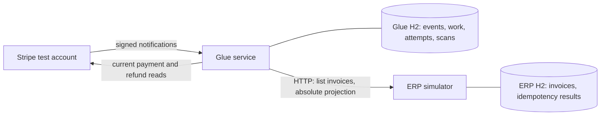

# Stripe-to-ERP Glue Service

A fictional ERP owns invoice facts; Stripe owns collected funds and refunds.
This integration keeps linked invoices current after duplicate, delayed, or
missing notifications, while holding incompatible records for operator review.
It provides at-least-once attempts with idempotent ERP effects.

Two independently running Java 21 / Spring Boot applications use separate
file-backed H2 databases. The implementation includes the invoice simulator,
signed webhook ingress, durable work, bounded retries, restart recovery,
reconciliation, operational APIs, OpenAPI, and metrics. Executed checks and
remaining environmental limits are in [the milestone log](docs/implementation-plan.md).



## Verify and demonstrate offline

Install JDK 21, then run from this repository's root:

```sh
./mvnw verify
python3 scripts/demo-offline.py
```

The wrapper pins Maven 3.9.16 with a SHA-256 checksum. Initial dependency downloads
need Maven Central; the default tests never call Stripe. No profile, credentials,
Docker daemon, or Stripe CLI is required. The tests use the real simulator over
HTTP and a deterministic Stripe HTTP stub, with controllable scheduling time and
on-disk restart checks.

Verification also checks production and test Java formatting, regular/static
wildcard imports, braces, and one statement per line. Apply formatting with
`./mvnw spotless:apply`; run just the style gates with
`./mvnw spotless:check checkstyle:check`. The pinned versions and responsibility
map are in the [refactoring review](docs/refactoring-review.md).

Both applications use feature-scoped Spring Data JPA repositories with constructor
injection. Services own the short multi-repository transactions; repository gate
queries retain pessimistic locking, and assigned IDs retain insert semantics.
The [persistence follow-up](docs/refactoring-review.md#spring-data-repository-follow-up)
records these choices and their regression evidence. Latest Maven verification
passed 77 tests. The [testing report](docs/testing-report.md) records the suite
inventory, measured coverage (90.57% lines; 74.50% branches), reproduction commands
and verification limits. Previous packaged-demo evidence, including retry recovery
across a JVM restart, is recorded in the milestone log.

The Python 3 demo starts both packaged applications on temporary ports with
separate temporary data directories and a local Stripe stub. It exercises a
10-invoice burst, a first missing webhook, a late refund, and a persisted retry
across an actual glue JVM restart. It reports measured elapsed time and removes
its own processes/data afterwards. It never creates real Stripe resources.

## Demo during normal application startup

Start the two applications as shown below, directly from Java, Maven or your IDE.
With no active profile configured they use the default `demo` profile, normal
ports **8080 / 8081**, and their normal databases under `data/glue-service` and
`data/erp-simulator`. No seeding command or separate demo instance is required.

The ERP adds these four fixtures during startup. Existing invoices and financial
edits are preserved, so a previously used database can contain more than four
invoices. A conflicting fixture identity fails startup without overwriting data;
all new seed writes roll back together.

| Invoice | Local payment | Initial invoice / work state |
| --- | --- | --- |
| inv_demo | pi_demo | PAID / DONE, with persisted attempts |
| inv_refunded | pi_refunded | REFUNDED / DONE |
| inv_unpaid | pi_unpaid | UNPAID / WAITING_PROVIDER |
| inv_review | pi_review | UNPAID / NEEDS_REVIEW, amount mismatch |

Open [glue Swagger](http://localhost:8080/swagger-ui.html) and
[ERP Swagger](http://localhost:8081/swagger-ui.html). `GET /invoices` lists all
invoices; `GET /invoices/{invoiceId}` returns one. Glue queues ordinary durable
work and reconciliation at startup; work/attempt results appear as the worker
processes those requests. Start ERP first for the quickest demonstration. A
brief reverse startup order is handled by the ordinary persisted retry policy.

The local Stripe fixture is managed inside the glue JVM, listening only on an
internal loopback port. The real SDK/HTTP adapter reads its synthetic test-mode
resources; unknown payment IDs return 404. It never contacts real Stripe or
creates financial resources. The demo profile enables the Swagger body-signing
hook with a public synthetic key; it rejects other credentials or a remote
provider. Use the explicit `sandbox` profile for real Stripe test access, as
described below. Maven tests select `test` automatically and control their own
fixtures; demo startup is covered separately by dedicated tests.

The default Paid PUT replays the seeded `demo-paid-v1` operation with the original
quoted `"1"` header. Refund writes need a new key and the latest invoice ETag.
Manual ERP edits do not change provider facts; later reconciliation can hold a
conflict for review. Creation reserves `inv_create` / `pi_create`: the first POST
returns 201; repeats return 409. Fault controls intentionally affect later writes.
Reset intentionally empties ERP; restarting ERP restores missing fixtures. Glue
operator holds survive reset/restart and need explicit requeue after the cause
is fixed. Error response examples describe failures, not successful operations.

The optional `python3 scripts/swagger-demo.py` convenience launcher starts these
same applications on 8080/8081 using the same normal database locations. It fails
if those ports are already occupied and never replaces a running application.
No Python process is needed when starting the two Java applications yourself.

Run the packaged startup/Swagger/restart check with:

```sh
python3 scripts/swagger-demo.py --check
```

It starts ordinary application JARs without a profile argument or external Stripe
server, using temporary ports/databases. It checks reverse startup ordering,
every documented endpoint, automatic data population, signature rejection and
deduplication, file persistence across both JVM restarts, operator-edit
preservation and reset/restart/requeue recovery, then cleans up its own resources.

## Run the applications

After `./mvnw verify`, use two terminals from the repository root:

```sh
java -jar erp-simulator/target/erp-simulator-0.1.0-SNAPSHOT-exec.jar
```

```sh
java -jar glue-service/target/glue-service-0.1.0-SNAPSHOT-exec.jar
```

The `exec` classifier contains executable Boot JARs. Plain JARs support the
simulator's test-only dependency in the glue integration suite; simulator classes
are absent from the glue runtime artifact. Migrations have module-specific
locations. No entities or repositories are shared between the runtime applications.

For IDE startup, import the root Maven project with JDK 21, then run
`ErpSimulatorApplication` and `GlueServiceApplication` as separate configurations,
using the repository root as working directory and local environment variables.
For terminal development with `spring-boot:run`, first install the reactor's
artifacts, then run one application per terminal:

```sh
./mvnw install -DskipTests
./mvnw -pl erp-simulator spring-boot:run
./mvnw -pl glue-service spring-boot:run
```

Stop each with Ctrl-C and start the same command to reuse its database. Run only
one glue instance and one process per H2 file.

| Application | Port | Default database file |
| --- | --- | --- |
| glue-service | 8080 | data/glue-service/glue.mv.db |
| erp-simulator | 8081 | data/erp-simulator/erp.mv.db |

Health: [glue](http://localhost:8080/actuator/health) and
[ERP](http://localhost:8081/actuator/health). Swagger UI:
[glue](http://localhost:8080/swagger-ui.html) and
[ERP](http://localhost:8081/swagger-ui.html). Generated OpenAPI: `/v3/api-docs`.
Both Swagger pages include a walkthrough, endpoint usage, parameter/header guidance,
and named request/response examples, including errors and empty results. Expand an
endpoint and select **Try it out**; select a named example for paid/refunded writes
or fault modes. Default local startup prepares the example IDs and signs webhook
requests automatically. In the explicit sandbox profile, use actual Stripe test
IDs and compute a fresh signature over the exact request body; its displayed
signature header is a placeholder. Bodyless operations explicitly say
to send no body, and 204 responses are empty. HTTP tests execute the generated ERP
and webhook examples and check the documents against representative responses.
Swagger documentation is maintained outside the controllers in
[glue-api.yaml](glue-service/src/main/resources/openapi/glue-api.yaml) and
[erp-api.yaml](erp-simulator/src/main/resources/openapi/erp-api.yaml). Edit those
resources for descriptions, parameters, status codes and examples. Each app's
OpenAPI configuration applies them to discovered routes; DTO schemas still come
from Java models. The optional demo-specific documentation and browser signing
hook live in [swagger-demo.yaml](glue-service/src/main/resources/openapi/swagger-demo.yaml)
and [swagger-demo-signing.js](glue-service/src/main/resources/openapi/swagger-demo-signing.js). Documented routes must match running controller mappings.
Health includes the local database. Flyway owns schema changes; JPA validates the
schema and Open Session in View is disabled.

## Postman localhost demo

Import the [Postman collection](postman/fde-localhost.postman_collection.json) and
[localhost environment](postman/localhost.postman_environment.json). The
[walkthrough](postman/README.md) covers a runnable ERP demo without Stripe, signed
sandbox notifications, work inspection, reconciliation, metrics and fault controls.
Run folders individually; the ERP-only folder uses synthetic references and should
run with glue stopped or a separate ERP database.

## Optional Stripe sandbox workflow

Set `SPRING_PROFILES_ACTIVE=sandbox` for both applications to disable automatic
demo seeding, the local provider fixture and automatic Swagger signing. Use fresh
`GLUE_DATA_DIR` / `ERP_DATA_DIR` locations for a sandbox session so synthetic demo
references are not sent to the real provider. Configure `STRIPE_SECRET_KEY` from
a local test/sandbox environment. Only `sk_test_`
or `rk_test_` keys are accepted; restricted keys need read permissions for runtime
and additional fixture permissions if used with the fixture tool. Keep secrets
in your local environment. Neither tests nor this repository require their values.

With a separately installed and authenticated Stripe CLI in the same sandbox,
forward the selected snapshot events:

```sh
stripe listen --events payment_intent.succeeded,payment_intent.payment_failed,refund.created,refund.updated,refund.failed --forward-to localhost:8080/webhooks/stripe
```

Set the printed signing secret as `STRIPE_WEBHOOK_SECRET` locally, then start the
glue application with both variables present. Terminal and IDE launches read
process environment variables; they do not automatically load `.env`.
The ERP can start without credentials. Missing glue credentials do not prevent
startup; webhook ingress returns 503 if its signing secret is missing, and queued
provider reads become visibly FAILED if the API key is missing.

Create a tagged sandbox PaymentIntent, link it in the ERP, then confirm with the
Stripe test payment method `pm_card_visa`:

```sh
python3 scripts/stripe-sandbox.py pay --invoice inv_demo_001 --amount 1200 --currency usd
curl --fail http://localhost:8080/operations/work
curl --fail http://localhost:8081/invoices/inv_demo_001
```

The fixture prints the PaymentIntent ID. To create its full sandbox refund:

```sh
python3 scripts/stripe-sandbox.py refund pi_REPLACE_WITH_FIXTURE_ID
```

This tool rejects live keys/resources and only refunds payments carrying its
`fde_demo` tag. Fixture creation is outside the runtime synchronization path.
Runtime code only reads Stripe. If the invoice link fails, the fixture payment
remains unconfirmed. Use fresh invoice IDs for repeated demonstrations.

## Operations and failure demonstrations

| Request | Behavior |
| --- | --- |
| POST /webhooks/stripe | SDK signature verification against exact raw body; atomic receipt/work commit before 200 |
| GET /operations/work?after=pi_cursor&limit=100 | Work state, reason, generations, retry counts, next eligible time, last known observed facts |
| GET /operations/work/{paymentIntentId} | Inspect one job |
| GET /operations/work/{paymentIntentId}/attempts?limit=100 | Latest attempt history |
| POST /operations/work/{paymentIntentId}/requeue | 202; explicitly release a FAILED/NEEDS_REVIEW hold and reset its retry budget |
| POST /operations/reconciliations | 202; enqueue or resume the current scan |
| GET /operations/reconciliations | Latest scan summaries; default limit 100 |
| GET /operations/reconciliations/{id} | State, persisted cursor, counts, failure history, completion time |

Inspect work before requeueing: fix the underlying configuration/business problem
first. New notifications and ordinary reconciliation preserve holds. Receipt is
not completion; inspect the job and ERP invoice to establish synchronization.
PaymentIntent waiting, terminal and unsupported states follow the explicit
[status policy](docs/design.md#4-financial-normalization); a confirmed cancellation
stops periodic provider refresh while leaving the invoice's financial facts intact.

The [ERP HTTP contract](contracts/erp-api.yaml) is authoritative for fixture,
projection, pagination, version, and fault-control details. For example, before
confirming a new sandbox payment, configure two failures before write:

```sh
curl --fail -X POST http://localhost:8081/demo/faults -H 'Content-Type: application/json' -d '{"mode":"FAIL_BEFORE_WRITE","remainingRequests":2}'
curl --fail -X POST http://localhost:8080/operations/reconciliations
curl --fail http://localhost:8081/demo/state
```

Use `APPLY_THEN_DELAY` with `delayMs: 3000` to exceed the default 2000 ms glue
transport timeout, or `VERSION_CONFLICT` for a stale-version response. Faults
apply to unseen projection keys; already-correct observations can be no-ops.
Replays and changed-payload conflicts do not consume configured faults.
`POST /demo/reset` clears only simulator data; it does not reset glue or Stripe.

Metrics are available under `/actuator/metrics`: `sync.work` with a `state` tag,
`sync.oldest.work.seconds`, `sync.attempt.latency`, and
`sync.reconciliation.last.outcome` (1 complete, 0 active/unstarted, -1 failed).
Logs include event, payment, invoice, operation, and attempt identifiers without
credentials or raw webhook payloads. Failure diagnostics retain bounded cause types,
application stack locations, and SQL state/vendor codes. Exception messages are
excluded because provider/SQL exceptions can contain request bodies or bound values.

HTTP problems use `reasonCode` and `message`, with optional `errors` entries
containing `field` and `message`. Malformed JSON, invalid fields/query parameters,
and missing required headers return 400 with safe details; rejected values are
not echoed. Webhook rejections retain their existing reason codes and now include
a message. Missing operational resources return a typed 404 problem.

The ERP timeout covers headers and complete response-body consumption. An expired
or interrupted request is canceled; a stalled body releases the worker and records
its normal durable retry. The same deadline protects reconciliation enumeration.

## Configuration and retry budget

Copy `.env.example` to `.env` only for Compose; process launches need exported
environment variables or IDE configuration. Local secrets and generated state are
ignored by Git.

| Environment variable / Spring property | Default |
| --- | --- |
| GLUE_PORT / ERP_PORT | 8080 / 8081 |
| GLUE_DATA_DIR / ERP_DATA_DIR | ./data/glue-service / ./data/erp-simulator |
| ERP_BASE_URL | http://localhost:8081 |
| STRIPE_SECRET_KEY / STRIPE_WEBHOOK_SECRET | empty |
| SYNC_ENABLED | true; false disables periodic worker/reconciliation execution |
| sync.poll-ms | 500 |
| sync.max-attempts | 5 transient-failure attempts, including the first |
| sync.retry-base-ms / sync.retry-max-ms | 1000 / 60000 |
| sync.provider-poll-ms | 30000 |
| sync.http-timeout-ms | 2000; Stripe connect/read timeout and ERP complete-response deadline |
| sync.reconciliation-ms | 60000 between full scan requests |
| sync.reconciliation-page-size / sync.reconciliation-batch-pages | 100 / 10 |
| sync.reconciliation-max-pages | 10000 committed pages per scan; persisted page count survives restart |

Override properties with Boot command-line flags, for example
`--sync.poll-ms=250`. The official Stripe SDK has zero network retries configured;
ERP transport has no configured retry layer. Application backoff is exponential,
persisted, and bounded; `Retry-After` seconds/dates are respected up to 60 seconds.
A stale ERP version permits at most three refreshed/revalidated writes inside one
attempt. Provider waiting does not consume transient-error retries.

Batches checkpoint their cursor with enqueued references in one local transaction.
A capped batch stays INCOMPLETE and the next batch resumes it; failed scans retain
the cursor and resume on a manual/periodic request. COMPLETE means enumeration
finished, not that every queued payment synchronized successfully.

The [ERP contract](contracts/erp-api.yaml) defines opaque cursor progress; the glue
service makes no ordering or invoice-ID assumptions. The per-scan page budget
bounds cyclic or unexpectedly large enumeration across batches/restarts. Exhaustion
records FAILED / ERP_ENUMERATION_LIMIT and keeps its checkpoint; it does not
pretend enumeration completed. Inspect the ERP pagination first. For a legitimate
larger scan, raise `sync.reconciliation-max-pages` and request reconciliation again
to resume the same failed run. Ordinary batch caps remain INCOMPLETE and resume
automatically without consuming this failure path.

## Docker Compose and limits

With a running Docker daemon and Compose v2:

```sh
docker compose up --build
docker compose down
```

Java 21 images are pinned by manifest digest. Containers run as a non-root user,
mount separate named volumes, and publish only localhost ports. `down` retains
those volumes. Compose supplies the internal ERP URL. Configuration validates;
image build/runtime remains unverified locally because Docker's daemon is unavailable.

The supported financial scope and reliability trade-offs are defined in
[the design](docs/design.md). This is a single-account, single-instance local
exercise. Operational/demo APIs have no production authorization layer. Invoice
IDs are URL-safe ASCII identifiers of at most 255 characters. Refund enumeration
has a visible 1000-page safety limit; reaching it holds the job rather than
reporting truncated facts as success. Reconciliation covers every registered ERP
reference, including paid/refunded invoices, and does not discover unlinked payments.

The worker runs one attempt at a time, adding remote latency to its 500 ms poll
interval. The latest measured local 10-invoice burst took 10.188 seconds; this is demo
throughput, not a production capacity claim. No real Stripe sandbox check was run.

## AI assistance

Codex assisted implementation, tests, documentation, and reliability review.
The candidate's brief supplied the financial rules and scope. Executable offline
tests and primary SDK documentation were used to check generated code; the
application runs deterministically without runtime AI. The
[AI usage record](docs/ai-usage.md) describes actual defects, corrections, checks,
and review limits. A human acceptance review remains the candidate's responsibility.

## Evidence and navigation

- [Acceptance scenarios and test mapping](docs/scenarios.md)
- [Milestones and executed checks](docs/implementation-plan.md)
- [Reliability review](docs/reliability-review.md) and [refactoring review](docs/refactoring-review.md)
- [Pinned dependencies and primary references](docs/references.md)
- [AI usage](docs/ai-usage.md), [development workflow](docs/workflows.md),
  [optional CodeGraph tooling](docs/agent-tooling.md), and [backlog](docs/backlog.md)
